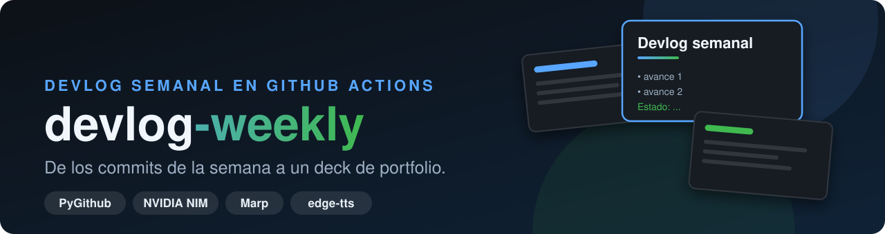
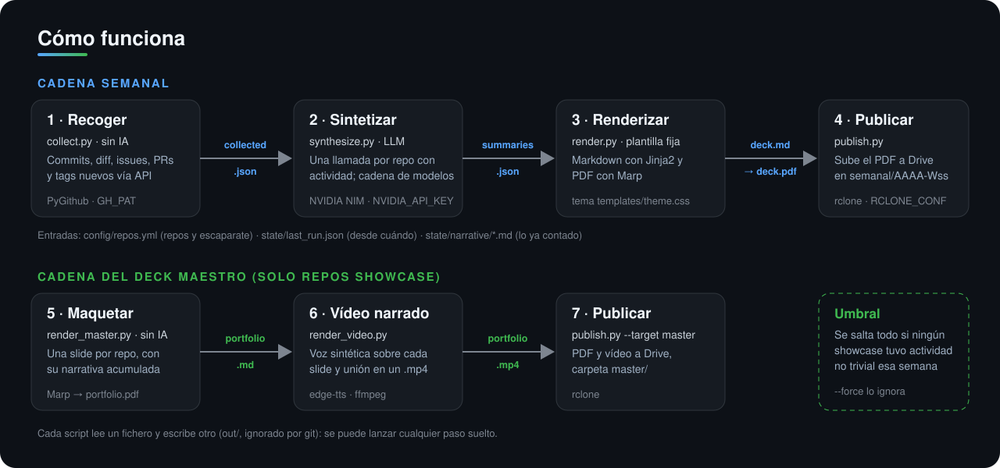
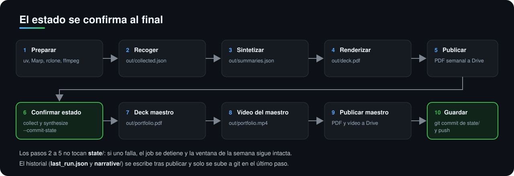

<div align="center">



<br>


**Cada lunes lee la actividad de tus repositorios de GitHub, la resume con un modelo de lenguaje
y genera un deck semanal en PDF, más un deck «maestro» de portfolio con vídeo narrado.**
Corre en GitHub Actions y sube los resultados a Google Drive.

[Qué hace](#qué-hace) ·
[Cómo funciona](#cómo-funciona) ·
[Estado](#estado-del-proyecto) ·
[Inicio rápido](#inicio-rápido) ·
[Configuración](#configuración) ·
[Límites](#límites-conocidos)

</div>

---

## Qué hace

| | |
|---|---|
| 📥 **Recoge** | Por cada repo de `config/repos.yml`: commits, estadísticas de diff, issues y PRs cerrados, tags nuevos, lenguajes y el arranque del README. Sin IA. |
| 🧠 **Resume** | Una llamada al modelo por repo con actividad, con el historial ya contado para que escriba *qué cambió* y no *qué es el proyecto*. |
| 📄 **Deck semanal** | Plantilla fija (Jinja2 + Marp) con el texto del modelo: un PDF con los avances de la semana. |
| 🗂️ **Deck maestro** | Un portfolio permanente con una slide por repo marcado como `showcase`, a partir de su narrativa acumulada. |
| 🎙️ **Vídeo narrado** | Las slides del deck maestro con voz sintética (edge-tts) unidas con ffmpeg en un `.mp4`. |
| ☁️ **Publica** | Sube los PDF y el vídeo a Google Drive con `rclone`, en carpetas por semana ISO. |

Pensado para quien mantiene varios repositorios y quiere un registro semanal y un portfolio al día sin
escribirlos a mano. Es un proyecto personal: la configuración incluida apunta a los repositorios de su autor.

## Cómo funciona



Cada script lee un fichero y escribe otro, así que cualquier paso se puede ejecutar suelto mientras se desarrolla.

### Orden del workflow y estado



El estado (`state/last_run.json` y `state/narrative/*.md`) no se actualiza al recoger ni al sintetizar, sino con
`--commit-state` después de publicar. Si algo falla antes, el workflow se detiene y la semana se puede reintentar sin
perder la ventana ni duplicar narrativa.

## Estado del proyecto

| Pieza | Estado | Nota |
|---|:---:|---|
| Recolección desde la API de GitHub | ✅ | Verificado 4/4 repos en W44; fallos de autorización y privacidad bloqueantes. |
| Síntesis con LLM (cadena de modelos de NVIDIA NIM) | 🟡 | Implementada. Solo se comprueba que la respuesta traiga las cuatro claves esperadas; no se valida el contenido. |
| Deck semanal (Marp → PDF) | ✅ | Generado y publicado en la ejecución W44. |
| Deck maestro y vídeo narrado | ✅ | PDF y MP4 publicados en W44; faltan tests específicos. |
| Publicación en Drive con rclone | 🟡 | Implementada; depende de un `rclone.conf` con OAuth propio. |
| Workflow semanal en GitHub Actions | 🟡 | Definido (lunes 07:00 UTC y disparo manual). El pipeline se recuperó el 29-10-2026: ejecución real W44 con 4/4 repos sintetizados, publicación de PDF semanal, PDF maestro y vídeo, y commit de estado en main. La generación histórica de semanas individuales no está reconstruida. |
| Tests automáticos | ✅ | 5 tests de regresión ejecutados con éxito en GitHub Actions el 29-10-2026. Cobertura todavía parcial. |

✅ probado · 🟡 implementado, pendiente de validar · 🚧 en construcción. El flujo W44 y los tests están verificados; la cobertura sigue siendo parcial.

## Inicio rápido

Requisitos para ejecutarlo en local: **Python 3.11+**, [`uv`](https://docs.astral.sh/uv/), y según el paso:
[Marp CLI](https://github.com/marp-team/marp-cli) (PDF), `ffmpeg` y `ffprobe` (vídeo) y `rclone` (publicar).

```bash
uv sync
export GH_PAT=...            # token de GitHub con acceso de lectura a los repos de la lista
uv run python src/collect.py --since 7d     # escribe out/collected.json
uv run python src/synthesize.py --dry-run   # solo imprime los prompts, sin llamar al modelo
```

`synthesize.py --dry-run` no necesita `NVIDIA_API_KEY` y es la forma segura de ver qué se enviaría al modelo.
Para ejecutarlo de verdad, define `NVIDIA_API_KEY` y quita `--dry-run`.

<details>
<summary><b>Resto de pasos y opciones</b></summary>

```bash
uv run python src/synthesize.py                 # out/summaries.json (--repo NOMBRE, --model ID, --no-state)
uv run python src/render.py --no-pdf            # solo out/deck.md; sin --no-pdf genera out/deck.pdf con Marp
uv run python src/publish.py --dry-run          # muestra el destino en Drive sin subir nada
uv run python src/render_master.py --force      # deck maestro ignorando el umbral (--no-pdf para solo Markdown)
uv run python src/render_video.py --force       # vídeo narrado (--voice es-ES-AlvaroNeural por defecto)
uv run python src/publish.py --target master    # sube portfolio.pdf y portfolio.mp4 si existen
```

Los comandos `--commit-state` (`collect.py` y `synthesize.py`) confirman el estado a partir de `out/`; en el workflow
se ejecutan tras publicar. Ojo: escriben en `state/`.

</details>

<details>
<summary><b>Ponerlo en marcha en tu propia cuenta (GitHub Actions)</b></summary>

1. Haz un fork o copia del repositorio y edita `config/repos.yml` con tus repos (`showcase: true` y `pitch` a mano
   para los de escaparate; esa decisión no la toma el modelo).
2. Añade los secretos del repositorio: `NVIDIA_API_KEY` y `RCLONE_CONF` (contenido de un `rclone.conf` con
   un remote de Google Drive ya autorizado; el nombre del remote por defecto es `gdrive`, o `RCLONE_REMOTE`).
3. Lanza el workflow `devlog semanal` a mano (`workflow_dispatch`) antes de fiarte del cron.

El workflow necesita permiso `contents: write` para guardar `state/`. El token temporal de GitHub Actions sustituye al PAT caducado para los repos públicos.

</details>

## Configuración

| Dónde | Para qué |
|---|---|
| `config/repos.yml` | Repos a seguir, `defaults.since_days` (ventana de la primera ejecución, 7 por defecto), `showcase` y `pitch`. |
| `GH_PAT` | Token de GitHub para leer los repos (con repos privados hace falta uno con acceso). |
| `NVIDIA_API_KEY` | Clave de NVIDIA NIM (API compatible con OpenAI). `NIM_MODEL` o `--model` fuerzan un único modelo. |
| `RCLONE_CONF`, `RCLONE_REMOTE` | Configuración de rclone y nombre del remote de Drive. |
| `templates/` | Plantillas Jinja2 de los decks y tema Marp `theme.css`. |

Los secretos van en variables de entorno o en los secretos de Actions, nunca en el repositorio.

## Límites conocidos

- **Cobertura de tests limitada.** Hay 5 pruebas de regresión y un job CI obligatorio, pero faltan tests de integración para renderizado, límites de tasa, Drive y modelos externos.
- **El texto lo escribe un modelo y nadie lo revisa.** Las narrativas y los titulares pueden contener errores o
  valoraciones no respaldadas por los commits. Revísalos antes de enseñarlos o publicarlos.
- **Qué sale de tu máquina.** Al sintetizar se envían a NVIDIA NIM el título de los commits, issues y PRs, los tags y
  la narrativa acumulada; con un `GH_PAT` que vea repos privados, eso incluye datos de repos privados. La narración del
  vídeo se envía al servicio de edge-tts (Microsoft) y el tema Marp carga fuentes de Google Fonts. El resultado se sube a
  tu Drive.
- **El modelo ve títulos, no diffs.** Recibe los títulos de commits y las cifras agregadas, no el código.
- **Síntesis incompleta bloqueante.** El proceso falla sin publicar ni actualizar estado cuando falte cualquier resumen.
- **Dependencia de servicios externos.** Los modelos listados pueden no estar habilitados para tu cuenta de NIM; si
  uno falla, se prueba el siguiente de la cadena.
- **El estado se guarda al final.** Si falla un paso después de confirmar el estado (deck maestro, vídeo, publicación
  maestra), el último paso de guardado no llega a ejecutarse y esa ventana se repetiría la semana siguiente.
- **Sin gestión explícita de límites de tasa** de la API de GitHub en `collect.py`.
- **Sin licencia.** El repositorio no incluye un archivo de licencia.

## Estructura del proyecto

```
src/
  collect.py        GitHub API -> out/collected.json (sin IA)
  synthesize.py     JSON + historial -> out/summaries.json (llamada al LLM)
  render.py         summaries -> out/deck.md -> out/deck.pdf (Marp)
  render_master.py  narrativas de los repos showcase -> out/portfolio.pdf
  render_video.py   portfolio -> out/portfolio.mp4 (edge-tts + ffmpeg)
  publish.py        PDF / vídeo -> Google Drive (rclone)
templates/          deck.md.j2, portfolio.md.j2 y tema theme.css
config/repos.yml    repos a seguir
state/              last_run.json y narrative/*.md, versionados por el workflow
.github/workflows/  weekly.yml (cron semanal, disparo manual y validación por push)
tests/              tests de regresión con unittest
docs/               gráficos del README y mapa del sistema (PSM)
```

## Documentación

- [`AGENTS.md`](AGENTS.md): directrices para agentes de IA que trabajan en el repositorio.
- [`docs/system-map/README.md`](docs/system-map/README.md): mapa del sistema (Project System Map). Parte de su contenido
  describe intenciones de diseño que no están todas implementadas.
- [`devlog-weekly-skeleton.md`](devlog-weekly-skeleton.md): brief original de diseño; algunas decisiones han cambiado
  (por ejemplo, el modelo usado ahora es NVIDIA NIM y no Anthropic).

---

<div align="center">

<sub>Proyecto personal. Las narrativas generadas por IA no están verificadas: revísalas antes de usarlas.</sub>

</div>

## Operación y recuperación (octubre de 2026)

- **Origen público:** el workflow usa `GITHUB_TOKEN` de GitHub Actions para leer exclusivamente los cuatro repos de `config/repos.yml`. El secreto `GH_PAT` anterior no se utiliza en Actions.
- **Fallos visibles:** errores de acceso a cualquier repo y síntesis incompleta terminan el job con error, sin publicar ni avanzar `state/`. El job `tests` es requisito del pipeline.
- **NVIDIA NIM:** la cadena antigua expiró en agosto de 2026. El 29-10-2026 se comprobó que `openai/gpt-oss-20b` funciona con esta cuenta y se situó como primer modelo. Las alternativas todavía requieren validación. Puede configurarse `NIM_MODEL` en el entorno de ejecución para fijar un modelo probado.
- **Drive:** `RCLONE_CONF` sigue siendo necesario. Se admiten los secretos opcionales `RCLONE_DRIVE_CLIENT_ID` y `RCLONE_DRIVE_CLIENT_SECRET` para usar OAuth propio, sin publicar los valores. Hasta configurarlos, la publicación dependerá del cliente compartido que rclone retirará en 2026.
- **Reprocesamiento:** el cursor se actualizó en `e2b0ae8` (29-10-2026). El informe W44 agrega lo pendiente desde agosto. El archivo W36 (parcial) a W43 se genera en un workflow independiente con metadatos fechados, sin modificar `state/` ni Drive.
- **Pruebas:** `uv run python -m unittest discover -s tests -v`.

La ejecución de GitHub Actions programada para los lunes sigue habilitada. La primera incorporación de esta reparación dispara también una ejecución por `push`, condicionada a superar los tests. Comprueba el resultado en Actions antes de dar por operativo el sistema.

## Histórico verificable (sin reescritura)

La reconstrucción W36 parcial–W43 utiliza **fechas reales** de commits,
issues y PRs cerradas de los cuatro repositorios públicos configurados.
No reinterpreta títulos con IA ni asigna etiquetas a una fecha histórica
sin evidencia. W36 empieza el 31-08-2026 a las 14:38:32 UTC, tras el
último run válido; el límite superior es exclusivo: 26-10-2026 00:00 UTC.

El módulo `src/backfill.py` crea informes Markdown y PDF (con Marp)
en `out/backfill/` y un `manifest.json` con los conteos reales.
No cambia `state/`, no toca los informes actuales de Drive y no utiliza
credenciales NVIDIA ni Google. El workflow `devlog histórico verificable`
los deja como artefactos de Actions descargables, con retención de 90 días.
Los informes históricos se deben revisar antes de distribuirlos.

El cron semanal y el disparo manual son los únicos que ejecutan
publicación de producción. Los cambios en archivos de código ejecutan
únicamente `devlog CI`, que no lleva secretos de servicios externos.
Las ejecuciones semanales están serializadas para no pisar el estado.

### Pendiente externo: OAuth propio de Google Drive

El servicio de Drive funcionó en la prueba W44, pero rclone emitió un
aviso sobre la retirada del `client_id` compartido. El código acepta
`RCLONE_DRIVE_CLIENT_ID` y `RCLONE_DRIVE_CLIENT_SECRET` como secretos
de Actions, sin exponer sus valores. Para activar la migración se necesita
crear/autorizar ese cliente en la cuenta Google; el conector de GitHub
no proporciona las credenciales ni permite escribir secretos de Actions.

## Archivo histórico durable en Drive

La reconstrucción crea primero un artefacto descargable de GitHub Actions.
Tras validarlo, `src/publish_backfill.py` archiva los 8 PDF, sus 8 Markdown
y el manifiesto en `Portfolio/historico-verificable/2026-W36__2026-W43/`.
Se utiliza `rclone copyto --immutable` para impedir sustituir otros
archivos. En particular NO se modifica `Portfolio/semanal/`,
`Portfolio/master/` ni el estado persistido de los repositorios.
Las credenciales OAuth siguen viniendo exclusivamente de Actions Secrets.
